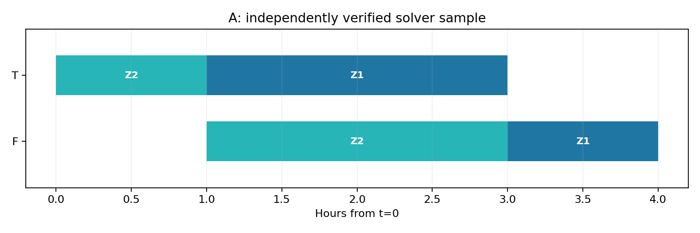
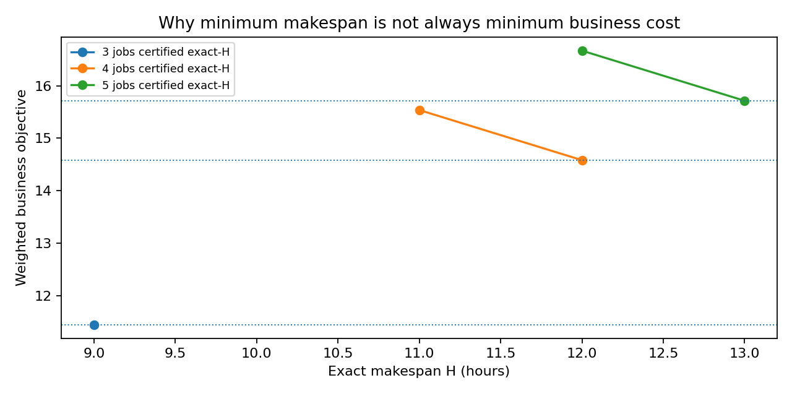

# AI-Native Quantum | QPoland Quantum Hackathon 2026
## AI-native hybrid quantum-classical production scheduling for MetalTech

**Team:** AI-Native Quantum · **Discord:** `@alexglee`  
**Deliverable:** two official scheduling baselines, a QUBO-based manufacturing extension, stage-by-stage experimental evidence, secure VeloxQ solver benchmarking and an auditable Colab demonstration.  
**License:** [MIT](LICENSE) · **Computing:** Qiskit Aer simulator + classical simulated annealing + OR-Tools CP-SAT + remote **GPU-based quantum-inspired** VeloxQ. No physical QPU or quantum advantage is claimed.

> **Video:** `VIDEO_URL_PENDING` — the real ≤5-minute demonstration video URL must be inserted by the team before submission. The repository package alone is not a submitted Google Form or recorded video.

### 1. Official required schedules

The two organizer-format JSON files are available directly in the repository root:

| Official benchmark | Required solver method | Observed outcome | File |
|---|---|---|---|
| 2 jobs × 2 machines (T → F) | QAOA sampled on Qiskit Aer | Valid **4 h** minimum makespan | [`schedule_2x2.json`](schedule_2x2.json) |
| 3 jobs × 3 machines (T → F → S) | QUBO solved with **classical** `neal` simulated annealing | Valid **8 h** minimum makespan | [`schedule_3x3.json`](schedule_3x3.json) |

The 2×2 actual quantum-circuit simulator sampled an optimal schedule 142 times in 4,096 original measurement shots; the fresh live demo observed 141 in 4,096. The QAOA depth-three parameter optimizer reached its iteration limit, so parameter convergence is not claimed. The official 3×3 fixed-H formulation used 39 binary variables and 181 pair interactions (72→39 candidates after valid time-window pruning). Existing CP-SAT runs independently reported both baseline optima.

### 2. Seven-stage integrated experiment

1. **Original problem:** MetalTech job sequences and official scheduling constraints.
2. **QUBO formulation:** one-hot start choices, precedence, machine overlaps, horizon windows and penalty weights.
3. **Mandatory baselines:** real Qiskit Aer QAOA sampling; classical QUBO simulated annealing; CP-SAT reference.
4. **Synthetic industrial extension:** planned milling outage, job deadlines, weighted tardiness and time-of-use power tariffs.
5. **Robustness and solver benchmarking:** penalty sensitivity, 3–5 synthetic jobs, QAOA depth, and two **actual VeloxQ GPU quantum-inspired** campaigns.
6. **Adaptive-horizon optimization:** exact-horizon QUBOs and independently certified multiobjective references.
7. **Scientific qualification:** validate feasibility, distinguish observed runs from reference computations, and state limitations.

**Stage 2's plant-power assumptions, customer deadlines and 4–5-job extensions are synthetic demonstrations, not additional official or real-factory input data.** The full objective is `makespan + 2 × weighted tardiness + 0.02 × electricity cost (USD)`. At 3 jobs, adding exact tariff price to the QUBO's **linear coefficients** adds no binary variables or pairwise interactions. In one observed synthetic comparison, electricity expenditure declined from **$23.56 to $22.28 (5.43%)** at unchanged makespan and weighted tardiness.

**Adaptive horizons:** for 4 jobs the recorded fixed minimum makespan H=11 yielded objective 15.5360 whereas H=12 reached **14.5808 (6.15% less)**. For 5 jobs H=12 yielded 16.6684 whereas H=13 reached **15.7132 (5.73% less)**. These match the previously reported unrestricted CP-SAT `OPTIMAL` references for those instances, demonstrating that the shortest schedule need not have the best composite business score.

### 3. VeloxQ: actual remote solver results, not a QPU

Four frozen binary QUBOs were run remotely in **two separate VeloxQ GPU-based quantum-inspired campaigns**, using `num_rep=256` and `num_steps=1500` per benchmark. The first matched three of four CP-SAT reference objectives; its five-job feasible schedule had a 0.163% gap. The subsequent live-demo campaign matched **all four** objectives, with the following archived results:

| Model | Bits / interactions | Independent reference | Live VeloxQ best | Feasible samples |
|---|---|---|---|---|
| Official 3 jobs, H=8 | 39 / 181 | 8 h | **8 h** | 229 / 256 |
| Energy-aware 3 jobs, H=9 | 40 / 180 | 11.4456 | **11.4456** | 211 / 256 |
| Adaptive 4 jobs, H=12 | 88 / 698 | 14.5808 | **14.5808** | 94 / 256 |
| Adaptive 5 jobs, H=13 | 128 / 1256 | 15.7132 | **15.7132** | 57 / 256 |

Feasible-sample proportions decline with more variables under these configurations; the four QUBOs differ in their constraints and are not a controlled scaling-law measurement. Recorded remote wall time includes service/API overhead, and we make **no classical-quantum performance superiority claim**. Initial and live outputs are preserved separately in [`evidence/`](evidence/).

### 4. Start here — Google Colab notebooks

| Goal | Notebook | Do you need to run it? |
|---|---|---|
| **Show actual fresh solver executions cell by cell** | [`01_LIVE_Seven_Stage_Demo.ipynb`](notebooks/01_LIVE_Seven_Stage_Demo.ipynb) | Yes. Requires internet; optional VeloxQ run needs a *private* API token. |
| **Present seven stages as slides + original code + recorded outputs** | [`02_PRESENT_Seven_Stage_Recorded_Results.ipynb`](notebooks/02_PRESENT_Seven_Stage_Recorded_Results.ipynb) | **No.** Results are embedded and shown immediately in Colab. |
| Reproduce official baselines and energy extension | [`03_Original_Baselines_Energy_Reference.ipynb`](notebooks/03_Original_Baselines_Energy_Reference.ipynb) | Yes; no VeloxQ token. |
| Reproduce robustness, scaling and QAOA-depth experiments | [`04_Stage_V_Robustness_Scaling.ipynb`](notebooks/04_Stage_V_Robustness_Scaling.ipynb) | Yes; no VeloxQ token. |
| Reproduce adaptive-horizon classical models | [`05_Stage_VI_Adaptive_Horizon.ipynb`](notebooks/05_Stage_VI_Adaptive_Horizon.ipynb) | Yes; no VeloxQ token. |
| Independently try VeloxQ with private masked input | [`06_Standalone_VeloxQ_Secure_Benchmark.ipynb`](notebooks/06_Standalone_VeloxQ_Secure_Benchmark.ipynb) | Yes; requires issued VeloxQ credentials. |

**Simple instructions:** click a notebook → **Open in Colab** (or download it, then upload via <https://colab.research.google.com/>, File → Upload notebook). For the **presentation** notebook, **do not Run all**; simply show the recorded code and output. For the **live demo**, run cells in order, including the dependency installer, and supply a **replacement** API key using the masked prompt only if choosing live VeloxQ execution. The public repository contains no key and cannot grant API access. Users without credentials may reproduce all local baseline and classical stages. The remote VeloxQ platform's availability, access limits and numerical samples may vary.

### 5. Reproduce and audit the supplied evidence without running solvers

- `python scripts/verify_submission.py` — verifies both required schedule JSONs, original and archived model hashes, original baseline QUBO energies, live remote result statuses and numerical references (no network/API or solver execution).
- `evidence/original_baselines/` — original 43-file, checksum-manifested QAOA + `neal` + CP-SAT evidence; other research campaigns are separately preserved under `evidence/robustness_scaling/`, `evidence/adaptive_horizon/`, `evidence/veloxq_initial_campaign/`, `evidence/live_demo/`.
- [`PROJECT_DESIGN.md`](PROJECT_DESIGN.md) — model, horizon, exact objective, penalties, assumptions and algorithms.
- [`DEVELOPMENT_LOG.md`](DEVELOPMENT_LOG.md) — dated decisions, failures, repairs and experiments.
- [`RESULTS_AND_VERIFICATION.md`](RESULTS_AND_VERIFICATION.md) — quantitative results, comparison limits, SHA manifests.
- [`AI_USAGE.md`](AI_USAGE.md) — AI assistance, human acceptance and roles.

The original baseline evidence's internal historical README predates VeloxQ runs. **The top-level README and documents are the current integration; older archived descriptions are immutable provenance, not current experiment-status statements.**

### 6. Disclosure, limits, and licensing

ChatGPT was used as **Agentic AI Project Coordinator (PC)** for experiment design, implementation drafts, debugging, analysis and documentation. The team Human Expert / PM scoped and directed tests and is responsible for factual acceptance, submission, and explanation. **Google Colab, Qiskit Aer, `neal`, OR-Tools CP-SAT and VeloxQ** performed actual computations as documented. This is a synthesis of established methods, not a claim of a newly invented optimizer. All project code and authored documentation are provided under the [MIT license](LICENSE); external libraries retain their own licenses. See [`AI_USAGE.md`](AI_USAGE.md).

### 7. Demo Video Link

**Demo Video:** [Watch our AI-Native Quantum Manufacturing Scheduling Demonstration](https://www.youtube.com/watch?v=qlwQ1HCuxsM)
